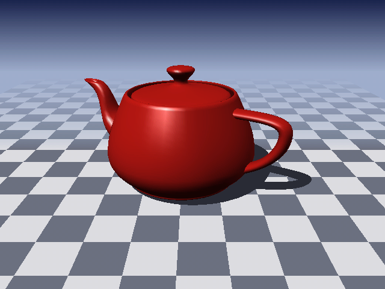
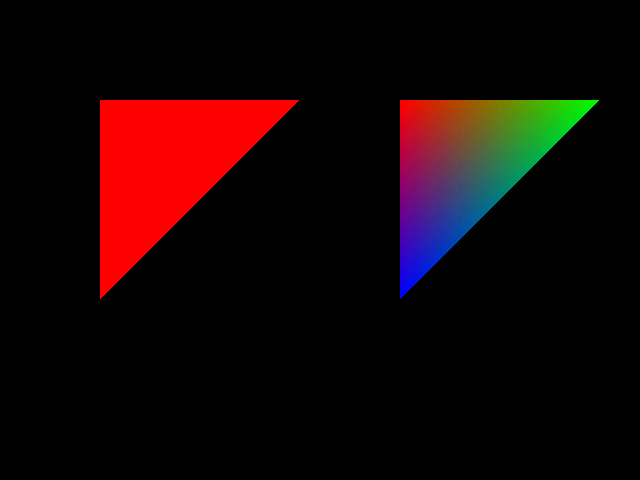
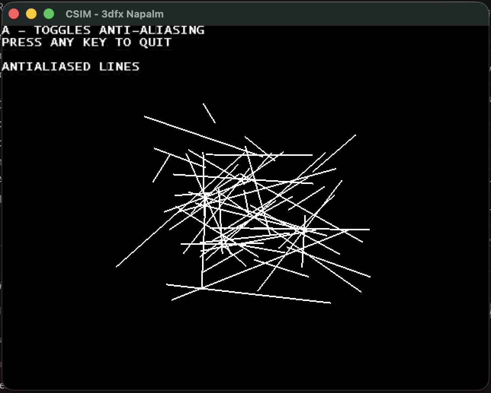

# 3dfx Glide API

This is the source code to 3Dfx Glide for Voodoo graphics accelerators. It's forked from the original CVS repo of Glide open source project at sourceforge:  https://sourceforge.net/projects/glide/

The code has been ported to CMake and works on all major modern platforms (Linux, macOS and Windows), and supports cross-compilation for Win9x. All builds are automated in the CI.

The source is licensed under 3DFX GLIDE Source Code General Public License.




The [Utah teapot](https://en.wikipedia.org/wiki/Utah_teapot) rendered with the Glide3 API from this repository on a 3dfx Napalm (VSA-100) chip simulator.


## CI Status


## Motivation
Although 3dfx disappeared from the market in 2000, there is still a large community of enthusiasts that enjoy using 3dfx video cards up to this day.
A part of these enthusiasts focus on providing software for modern-day operating systems, and this is where this project comes in.

The Glide API is, similar to OpenGL/Direct3D, a 3D API. It is used by many old-school video games, and in order to run these games on present-day OS, the Glide API libraries need to be available.

This project is a port of the Open-Source Linux Glide libraries, and supports cross-platform builds for Linux and Windows, both x86 and x64.

The toolchain is ported to CMake to simplify cross-platform builds, and get rid of a large set of hard-to-use makefiles.


## `CSIM` - The Chip Simulator


> The process of driver development and testing with the CSIM will allow significant portions of the hardware design and driver implementation to be verified well before chips come back. The act of writing the driver should flesh out any problems with the software interface to the chip. [...]
(quote of the 3dfx engineers)

3dfx engineers initially used a software implementation (`CSIM`) of the Napalm chip to test driver development. Although leaked, the source code of this simulator is proprietary. However, it gives us insights into how the Napalm chip behaves internally: how the command FIFO takes the commands from the driver, how the registers are mapped, and more. This knowledge was used to re-implement the chip simulator in C++ (`swlibs/csim`).



The simulator allows developing and testing the Glide API even for systems where 3dfx hardware is not available. It can be used on all major platforms (Windows, Linux and macOS).

The current implementation is still very basic and only supports triangle rendering and a limited featureset of one TMU. Geometry transformation and lighting are calculated on the CPU, just like in real Glide games of the time.

The chip simulator displays the rendering output in a separate window. On Windows, it uses the Win32 API, on Linux and macOS it uses Qt. The window can be turned off for unit or CI tests using a CMake switch.

The chip simulator is not a Glide emulator: it does not wrap the Glide calls to a different rendering API such as OpenGL. Instead, this simulator sits one level lower and simulates the 3dfx chip itself. The Glide API works exactly as it does with a real 3dfx video card. The chip simulator pretends to be a 3dfx device (`0x121A`), and is then initialized by the Glide API.

The simulator is very slow, but speed was not the goal. Instead, `CSIM` was developed to replicate the real 3dfx hardware as accurate as possible. Although not implemented yet, it will include all the original features and quirks, such as T-Buffer effects, RGSS anti-aliasing, and SLI artifacts.

### The 3dfx SDK Examples
`examples/3dfx` contains the original test programs of the 3dfx Glide3 SDK (`test00` to `test49`, `sbench` and `display`), each showing one Glide feature. They are built with `-DGLIDE_BUILD_3DFX_EXAMPLES=ON`. With `-DBUILD_HAL_CSIM=ON`, they run on the chip simulator.



`test24` running 3dfx Glide on macOS using the chip simulator (anti-aliasing is not working yet).

Build the examples as follows:
```sh
mkdir bin_examples
cd bin_examples
cmake -DBUILD_HAL_CSIM=ON -DGLIDE_BUILD_3DFX_EXAMPLES=ON ..
cmake --build .
ctest -L 3dfx
```
Because they were originally designed for standalone running, `ctest` runs every program for 3 frames and writes the rendered images to `examples/3dfx/images` in the build directory. Started by hand, the program runs normally as designed by 3dfx.

## How to Build?
The libraries are built under Linux, using the `mingw-w64` cross-platform compiler. The Glide3x library for Voodoo3/4/5 is also built with Visual Studio in the GitHub Actions CI environment, and its HAL_CSIM build is tested there with the chip simulator.

The Glide API comes in two versions, Glide2x and Glide3x. Both versions have different libraries for the video card series they are supporting:
* sst1 is for Voodoo1 cards
* cvg is for Voodoo2 cards
* h3 (Glide2x only) is for Voodoo Banshee/Voodoo3/Velocity cards
* h5 (Glide3x only) is for Voodoo Banshee/Voodoo3/Velocity and Voodoo4/5 cards

The simplest way to build the libraries is to use the provided docker container, and refer to the build steps of the GitHub Actions.


The struct offset headers `fxgasm.h` and `fxinline.h` are generated automatically during the build, with the same compiler and configuration as the DLL. Do not copy them into the source directories, the build stops if it finds old copies there.

### Build Example (Windows 98, MinGW cross compile)

Windows 9x requires a 32-bit MinGW build. The `mingw-w64-x86_32.cmake` toolchain files set up everything needed for it:
* code is generated for Pentium CPUs (override with `-DGLIDE_TARGET_CPU=...`),
* the DLL is marked as compatible with Windows 4.0,
* libgcc is linked statically.

After linking, the build checks that the DLL does not require a newer Windows version and does not import DLLs that are missing on Windows 9x (e.g. `libgcc_s`, `libwinpthread` or the Universal CRT). This check can be disabled with `-DGLIDE_CHECK_WIN9X=OFF`.

Glide3 for Voodoo3/4/5, from the repository root:
```sh
mkdir bin_win_x32
cd bin_win_x32
cmake -DCMAKE_TOOLCHAIN_FILE=../mingw-w64-x86_32.cmake ..
cmake --build .
```
The other libraries are built the same way from their directories (e.g. `glide2x/cvg`), using the toolchain file in that directory.

`BUILD_32BIT` is detected from the compiler. It only needs to be set for native 32-bit Linux builds (`-DBUILD_32BIT=ON`, which adds `-m32`).

### Build Example (Windows, Visual Studio)

Let's build the Glide3 DLL for Voodoo3/4/5 using Visual Studio. Note that the DLLs only work on Windows 9x when built with a compiler that still supports it (Visual Studio 2005 or older), current Visual Studio versions cannot target Windows 9x.

#### Run FX Build Number Header Generator

Go to the Glide3 source directory, and create a binary directory.
```ps1
cd glide3x\h5\glide3\src\fxbldno_tool
mkdir bin_win32
cd bin_win32
```

Generate project, build, generate header files... 
```ps1
cmake -A Win32 ..
cmake --build .
cd ../..
./fxbldno_tool/bin_win32/Debug/fxbldno > fxbldno.h
```

#### Generate the Glide3 DLL
Move back to the repository root, and generate the build directory.
```ps1
cd ..\..\..\..
mkdir bin_win32
cd bin_win32
```
Similar to the steps before, generate your Visual Studio solution, and build the DLL.
```ps1
cmake -A Win32 ..
cmake --build .
```
The glide3x.dll should be generated in the bin_win32\glide3x\h5\Debug directory, ready for use.

### Linux DRI / `tdfx` Build (Obsolete)

Glide3x for Voodoo3/4/5 can be built in two ways on Linux:
* **Standalone (the default)**: Glide programs the card itself, through `minihwc`. It sets the video mode and accesses the hardware directly, so it needs root rights or the `/dev/3dfx` device, and takes over the screen. This is what Glide games and the examples use.
* **DRI** (`-DUSE_DRI=ON`): Glide is the backend of Mesa's `tdfx` OpenGL driver (`tdfx_dri.so`), and cannot be used directly by programs. The X server (`xf86-video-tdfx`) and the `tdfx` kernel module own the card. Mesa hands Glide the mapped registers, the frame buffer and the window position through the `grDRI*` functions of `glide3x/h5/minihwc/linhwc.c`, which replaces `minihwc`. This gave OpenGL acceleration on the X desktop, e.g. for Quake 3 on Linux.

The DRI build is obsolete, as all the other parts it needs have been removed from Linux:
* Mesa removed the `tdfx` driver, and all other DRI1 drivers, in Mesa 8.0 (February 2012). Mesa 7.11 is the last version with it.
* The `tdfx` kernel module was marked obsolete in 2016, and removed in Linux 6.3 (April 2023).

So it only works on Linux distributions from 2011 or older, which also had the matching X server.

The DRI build needs the X11 headers (`libx11-dev` and `libxxf86vm-dev` on Debian/Ubuntu):
```sh
mkdir bin_dri
cd bin_dri
cmake -DCMAKE_BUILD_TYPE=Release -DUSE_DRI=ON ..
cmake --build .
```
Mesa's `tdfx_dri.so` loads `libglide3-v5.so` (Voodoo4/5) or `libglide3.so`, so install the built `glide3x/h5/libGlide3x.so` under one of these names. The CI only compiles the DRI build, but i have never tested it with Mesa.

## Where to Download?
The libraries are automatically built by the CI for every commit, so you can also use the CI builds (see the "Actions" tab https://github.com/Danaozhong/3dfx-Glide-API/actions for the download link).

